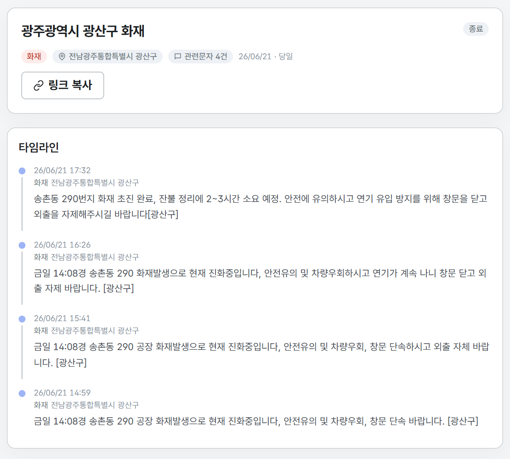
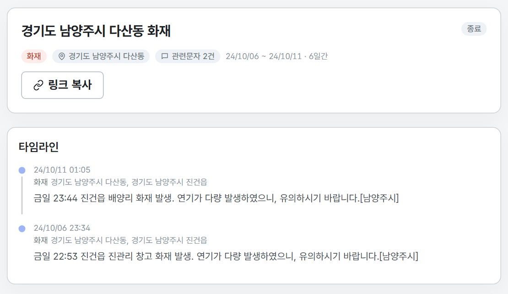
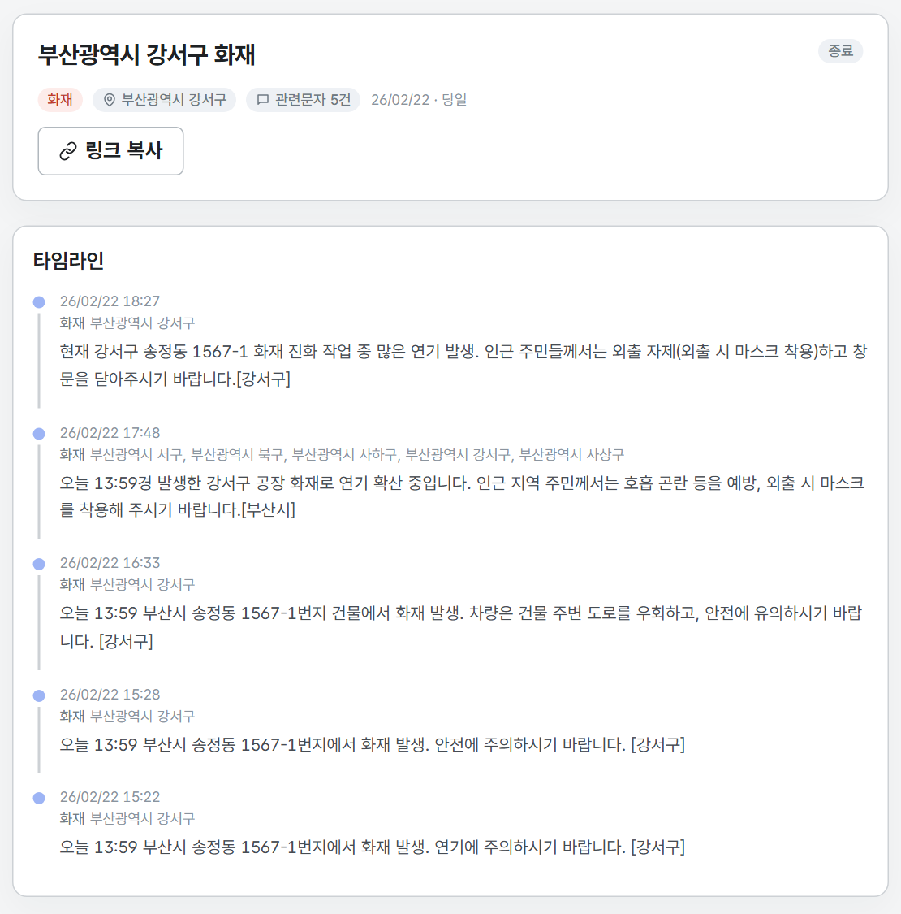
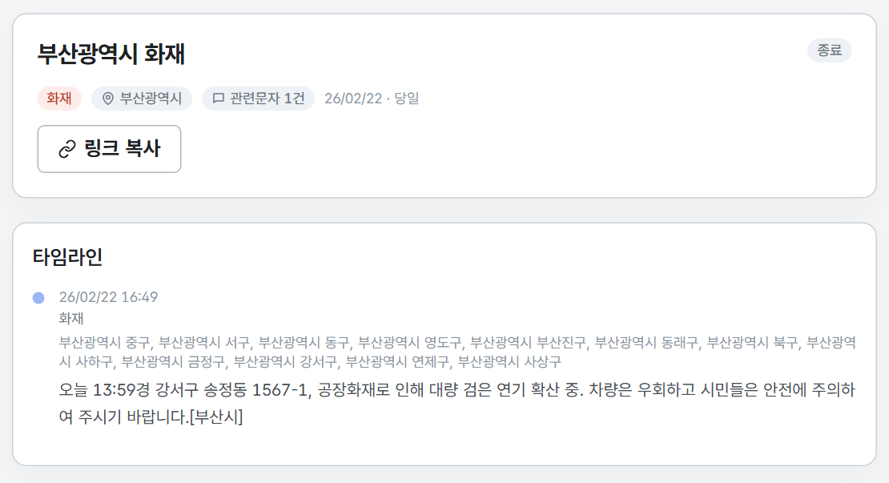
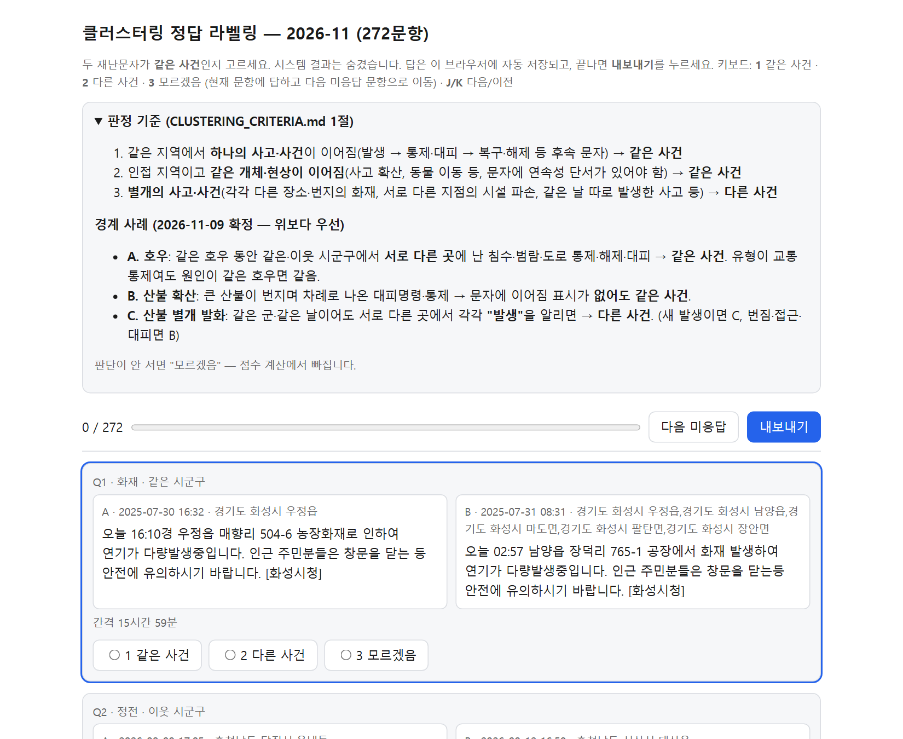
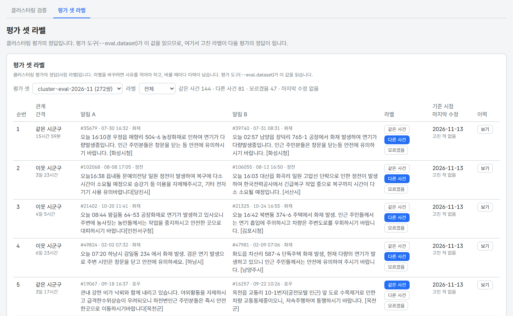
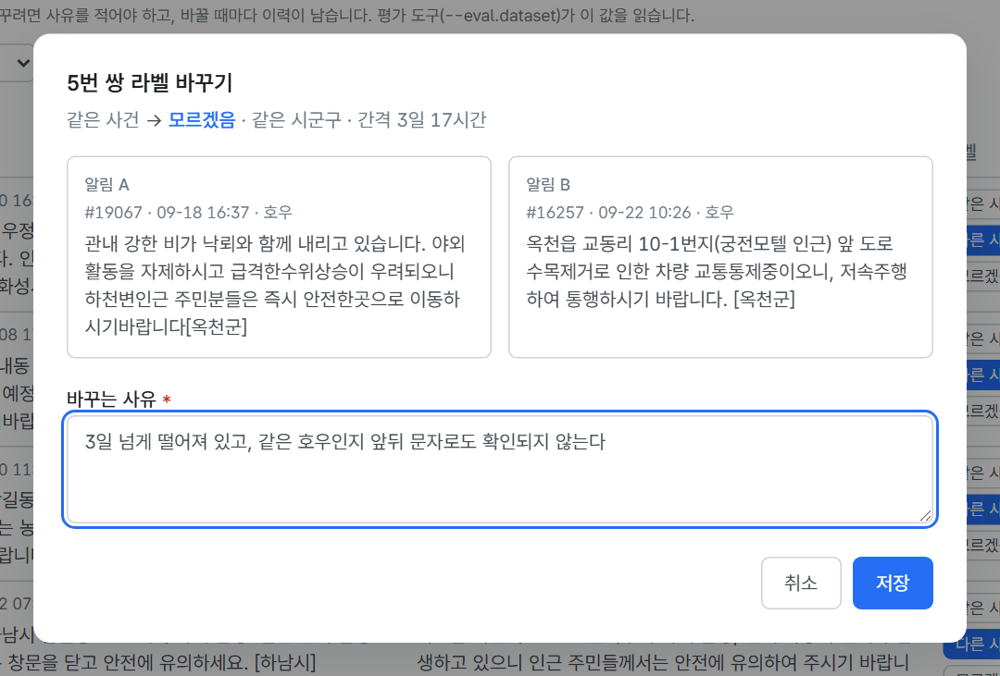

<nav class="toc" aria-label="목차">
<ol>
<li><a href="#1-어떤-기능을-검증하려고-했나"><span class="toc-num">01</span><span class="toc-text"><strong>어떤 기능을 검증하려고 했나</strong><span>같은 사건의 재난문자를 이벤트 하나로 묶는 기능</span></span></a></li>
<li><a href="#2-왜-검증이-필요했나--엔드투엔드에서-본-두-가지-실수"><span class="toc-num">02</span><span class="toc-text"><strong>왜 검증이 필요했나</strong><span>다른 화재를 묶고, 같은 화재를 나눈 두 가지 실수</span></span></a></li>
<li><a href="#3-정답-데이터를-만드는-과정"><span class="toc-num">03</span><span class="toc-text"><strong>정답 데이터를 만드는 과정</strong><span>헷갈리는 범위에서 272쌍을 뽑아 사람이 판정</span></span></a></li>
<li><a href="#4-라벨링-기준이-흔들린-문제와-해결"><span class="toc-num">04</span><span class="toc-text"><strong>기준이 흔들린 문제와 해결</strong><span>라벨링을 멈추고 기준을 명세 문서로 고정</span></span></a></li>
<li><a href="#5-그다음-라벨을-관리자-화면에서-관리하게-했다"><span class="toc-num">05</span><span class="toc-text"><strong>라벨을 관리자 화면에서 관리</strong><span>사유를 적어야 고치고, 이력이 남는다</span></span></a></li>
<li><a href="#6-점수는-어떻게-매기나"><span class="toc-num">06</span><span class="toc-text"><strong>점수는 어떻게 매기나</strong><span>F1(조화평균) 점수 하나로 성능을 수치화</span></span></a></li>
</ol>
</nav>

## 1. 어떤 기능을 검증하려고 했나

[재난 안전 문자 아카이브](https://github.com/lshlsh3690/disaster-alert-archive)는 휴대폰으로 오는 정부 재난문자를 모아 보여 주는 서비스다. 재난문자는 하나의 사건에 대해서도 여러 번 온다. 공장에 불이 나면 "화재 발생 → 진화 중 → 초진 완료" 문자가 몇 시간에 걸쳐 따로따로 온다.

문자를 시간순으로 늘어놓기만 하면 보는 사람이 직접 이어 맞춰야 한다. 그래서 같은 사건에 관한 문자들을 하나의 **이벤트**로 묶어 보여 주는 기능을 만들었다. 이렇게 비슷한 것끼리 묶는 일을 **클러스터링**이라고 부른다. 실제로 묶인 화면은 이렇다.



*2026-06-21 광주 광산구 송촌동 공장 화재. 2시간 반 동안 온 문자 4건이 한 이벤트로 묶여, "발생 → 진화 중 → 초진 완료" 흐름이 한눈에 보인다.*

묶는 방법을 아주 짧게 설명하면 이렇다.

- 문자 문장을 숫자 목록(**임베딩**)으로 바꾼다. 뜻이 비슷한 문장은 비슷한 숫자 목록이 된다.
- 같은 재난 유형, 같은 지역, 가까운 시간이라는 조건을 먼저 건다.
- 그 안에서 문장이 충분히 비슷하면 같은 이벤트에 붙인다.
- 애매한 경우에만 LLM(GPT)에게 "이 두 문자가 같은 사건이냐"고 물어본다.

## 2. 왜 검증이 필요했나 — 엔드투엔드에서 본 두 가지 실수

클러스터링 결과는 화면으로 보면 대체로 그럴듯해 보인다. 하지만 문자 하나가 들어와 이벤트에 붙기까지의 전체 과정, 즉 **엔드투엔드** 결과를 하나씩 맞춰 보니 서로 반대 방향의 실수가 두 가지 있었다.

### 과병합: 다른 사건인데 하나로 묶었다



*이벤트 하나("남양주시 화재", 6일간)의 타임라인에 서로 다른 두 화재가 섞여 있다.*

4일 떨어져 서로 다른 마을(진관리, 배양리)에서 난 **별개의 화재**인데, 시스템은 하나의 이벤트로 묶었다.

- 원인은 시청이 같은 문장 틀로 문자를 보낸다는 점이다. 장소와 시각만 다르고 나머지 문장이 똑같다.
- 그래서 두 문장의 임베딩 거리가 0.118로 아주 가깝게 나왔다. 거리는 0이면 똑같은 문장이고 클수록 다른 문장이며, 이 시스템은 0.15 이하면 바로 묶는다.
- "문장이 비슷하다"와 "같은 사건이다"는 다른 말이었다.

### 과소병합: 같은 사건인데 따로 뒀다





*같은 화재가 "부산광역시 강서구 화재"(문자 5건)와 "부산광역시 화재"(문자 1건) 두 이벤트로 나뉘었다.*

2026-02-22 부산 강서구 송정동 1567-1 공장 화재다. 두 이벤트의 문자 모두 **같은 주소, 같은 발생 시각(13:59)** 을 적고 있으니 사람이 보면 누가 봐도 한 사건인데, 시스템은 부산시가 16:49에 보낸 문자 1건을 **따로** 떼어 두었다.

- 이 문자와 강서구 문자의 임베딩 거리는 0.216으로, 바로 묶는 기준(0.15)을 조금 넘었다.
- 문장 유사도는 "같은 사건인가"를 대신하지 못한다. 거리가 조금만 벌어져도 같은 사건이 둘로 갈라진다.

### 그래서 검증을 시작했다

- **두 실수는 반대 방향이다.** 묶는 기준을 느슨하게 하면 과소병합은 줄지만 과병합이 늘고, 기준을 엄격하게 하면 그 반대가 된다. 한쪽을 고칠 때 다른 쪽이 얼마나 망가지는지 숫자로 볼 수 있어야 했다.
- **단위 테스트로는 잡히지 않는다.** 단위 테스트는 "코드가 의도대로 도는가"를 확인할 뿐, "묶은 결과가 맞는가"는 알려 주지 않는다. 위 두 사례도 테스트는 모두 통과한 상태에서 나왔다.
- **눈으로 사례를 찾는 데는 한계가 있다.** 이런 실수를 우연히 발견할 때마다 고치면, 고친 뒤 전체적으로 좋아졌는지 나빠졌는지 알 수 없다.

그래서 **사람이 매긴 정답 셋**을 두고, 무언가를 바꿀 때마다 같은 정답으로 다시 재는 검증 파이프라인을 만들기로 했다.

## 3. 정답 데이터를 만드는 과정

정답은 **문자 두 개(쌍)** 를 보여 주고 사람이 "같은 사건 / 다른 사건 / 모르겠음" 중 하나로 판정하는 방식으로 만들었다. 사람이 매긴 이 답을 **라벨**, 라벨을 매기는 작업을 **라벨링**이라고 부른다. 판단이 안 서는 쌍은 억지로 고르지 않고 "모르겠음"으로 두고 점수 계산에서 뺀다.

만드는 과정은 네 단계였다.

1. **평가용 DB 준비** — 운영 DB 를 복사해 평가 전용 DB 를 만든다. 운영 데이터를 건드리지 않고 마음껏 다시 묶어 볼 수 있다.
2. **후보 쌍을 골라 무작위로 뽑기** — 아무 문자 두 개나 뽑으면 "서울 화재 vs 부산 호우"처럼 뻔한 쌍만 나와 평가에 도움이 안 된다. 그래서 시스템이 실제로 헷갈리는 범위, 즉 **같은 재난 유형 · 7일 안 · 같은 시군구이거나 이웃 시군구**인 쌍만 후보로 삼고, 그중에서 화재·호우·산불·기타 사고의 비율을 맞춰 무작위로 뽑았다. 이렇게 **272쌍**이 나왔다.
3. **사람이 판정하기** — 아래 퀴즈 화면에서 272쌍을 하나씩 판정했다.
4. **정답 파일로 저장하기** — 판정 결과를 JSON 파일로 내보내 저장소에 두고, 평가 도구가 이 파일을 읽어 시스템 결과와 비교한다.

### 라벨링 화면

라벨링은 HTML 파일 하나로 만든 퀴즈로 했다. 서버 없이 브라우저에서 바로 열린다.



*2026-11 라벨링에 쓴 퀴즈 화면. 위쪽 판정 기준은 당시 버전이라 지금 기준(A 의 "이웃 시군구" 부분)과 조금 다르다.*

## 4. 라벨링 기준이 흔들린 문제와 해결

### 문제: 라벨링하다 보니 기준이 자꾸 흔들렸다

라벨링 결과를 모아 보니, 같은 호우 동안 같은 지역에서 나온 비슷한 구조의 쌍이 어떤 것은 "같은 사건"(12쌍), 어떤 것은 "다른 사건"(5쌍)으로 매겨져 있었다. 그날그날 판단이 달랐던 것이다.

헷갈릴 때마다 규칙을 하나씩 더했지만(A, B, C … H), 결국 "같은 하천이면 날짜와 상관없이 같은 사건"(H)이 "같은 호우 동안만 같은 사건"(A)과 부딪쳐 한 쌍에 두 답이 나왔다. 정답이 흔들리면 점수가 오른 게 시스템 덕인지 내 판단이 바뀐 탓인지 구분할 수 없다. 그래서 **라벨링을 멈췄다.**

### 해결: SDD — 라벨보다 명세를 먼저

**SDD(Spec-Driven Development, 명세 주도 개발)** 는 코드를 쓰기 전에 "무엇을 만들어야 하는가"를 명세 문서로 먼저 확정하는 방식이다. 이걸 라벨링에 적용했다. 라벨을 더 매기기 전에 "무엇을 같은 사건으로 볼 것인가"를 문서로 확정한 것이다.

### 기준 문서는 딱 하나만 둔다

판정 기준의 본문은 `CLUSTERING_CRITERIA.md` 한 파일에만 쓰고, 다른 문서는 그 파일을 가리키기만 한다. 같은 내용을 여러 곳에 적어 두면 한쪽만 고쳐져 서로 어긋나는 일이 실제로 있었기 때문이다.

최종 기준은 원칙 3개와 경계 사례들로 이뤄진다.

1. 같은 지역에서 하나의 사고가 이어지면(발생 → 통제 → 해제) **같은 사건**
2. 이웃 지역이라도 같은 현상이 이어진 단서가 있으면(산불 확산, 동물 이동) **같은 사건**
3. 서로 다른 장소에서 따로 난 사고(번지가 다른 화재 등)는 **다른 사건**

| 경계 사례 | 규칙 |
|---|---|
| A. 호우 | 같은 호우 동안 **같은 시군구**의 서로 다른 피해 → 같은 사건. 이웃 시군구는 다른 사건 |
| B. 산불 확산 | 번지며 차례로 나온 대피명령 → 같은 사건 |
| C. 산불 별개 발화 | 서로 다른 곳에서 각각 "발생" → 다른 사건 |
| D. 여러 시군구로 보낸 문자 | 발신 기관의 시군구로 본다 |
| E. 이름이 바뀐 행정구역 | 발신 기관(옛 구청) 기준 |
| F. 해제는 끝이 아니다 | 해제 뒤 재통제가 흔하므로 해제로 사건을 끊지 않는다 |
| G. 이름이 같은 한 시설 | 같은 다리·하천을 같은 비 동안 통제 → 시군구가 달라도 같은 사건 |
| I. 시군구가 아닌 발신 기관 | 문자에 적힌 장소의 시군구로 본다 |

판정 기준 전문(원칙, 경계 사례별 이유와 예시, 적용 순서)은 [CLUSTERING_CRITERIA.md](https://github.com/lshlsh3690/disaster-alert-archive/blob/develop/specs/001-event-clustering-pipeline/CLUSTERING_CRITERIA.md) 에 있다.

## 5. 그다음: 라벨을 관리자 화면에서 관리하게 했다

기준이 고정되고 나니 다음 문제가 보였다. 라벨은 저장소의 JSON 파일 하나였다. 라벨 하나를 고치려면 파일을 직접 열어 고쳐야 했고, **누가 언제 왜 고쳤는지**가 남지 않았다. 기준을 바꾸면 라벨을 다시 본다는 절차를 만들었는데, 그 기록이 남지 않는 셈이었다.

그래서 라벨을 DB 로 옮기고 관리자 화면을 만들었다.



*평가 셋을 고르면 쌍마다 관계(같은/이웃 시군구), 두 문자의 간격, 원문, 현재 라벨이 보인다.*

라벨을 바꾸려고 버튼을 누르면 사유를 적는 창이 뜬다. **사유를 적지 않으면 저장할 수 없다.**



*바꾸기 전 → 후 라벨과 두 문자를 다시 보여 주고, 사유를 받는다. (화면은 예시 입력이고 저장하지 않았다.)*

- 저장하면 이력(이전 라벨 → 새 라벨, 사유, 바꾼 사람, 시각)이 따로 쌓인다.
- 평가 도구는 이제 파일 대신 DB 의 평가 셋을 바로 읽는다. 화면에서 고친 라벨이 다음 평가의 정답이 된다.

## 6. 점수는 어떻게 매기나

### 쌍 하나를 세는 법

시스템 결과와 사람 라벨을 비교하면 쌍마다 네 경우가 나온다.

| 사람 라벨 | 시스템 | 이름 |
|---|---|---|
| 같은 사건 | 같은 이벤트로 묶음 | **맞게 묶음** |
| 같은 사건 | 따로 둠 | **과소병합** — 묶어야 하는데 못 묶음 |
| 다른 사건 | 같은 이벤트로 묶음 | **과병합** — 묶으면 안 되는데 묶음 |
| 다른 사건 | 따로 둠 | 세지 않음 |

여기서 두 비율을 계산한다.

- **맞게 묶은 비율** = 맞게 묶음 ÷ (맞게 묶음 + 과병합). "시스템이 묶은 것 중 몇 %가 맞았나"이다. 머신러닝 용어로는 정밀도(precision)다.
- **빠짐없이 묶은 비율** = 맞게 묶음 ÷ (맞게 묶음 + 과소병합). "묶어야 할 것 중 몇 %를 묶었나"이다. 재현율(recall)이다.

### 점수 하나로 합칠 때 조화평균(F1)을 쓰는 이유

두 비율을 점수 하나로 합칠 때 **조화평균**을 쓴다. 머신러닝에서 F1 점수라고 부르는 것과 같은 계산이다.

```text
점수 = 2 × 맞게 묶음 ÷ (2 × 맞게 묶음 + 과소병합 + 과병합)
```

왜 그냥 평균이 아닐까? 극단적인 예로 보면 바로 보인다.

| 시스템 | 맞게 묶은 비율 | 빠짐없이 묶은 비율 | 그냥 평균 | 조화평균 |
|---|---:|---:|---:|---:|
| 실제 시스템(2026-11-11) | 89.5% | 69.9% | 79.7 | **78.5** |
| 모든 문자를 하나로 묶음 | 5% | 100% | 52.5 | **9.5** |
| 모든 문자를 따로 둠 | — | 0% | — | **0** |

- "전부 하나로 묶기"는 아무 쓸모가 없는데, 그냥 평균으로는 52.5점이나 받는다. 조화평균은 낮은 쪽으로 끌려 내려가서 9.5점이 된다.
- 두 오류는 서로 반대 방향이다. 하나만 보면 쉽게 속는다. 다 묶으면 과소병합이 0, 다 따로 두면 과병합이 0이 된다.
- "다른 사건인데 따로 둠" 칸을 세지 않는 이유도 같다. 이 칸은 아무것도 안 묶으면 저절로 늘어나서, 넣으면 점수가 부풀려진다.

최종적으로 이 **F1(조화평균) 점수가 이벤트 클러스터링의 성능 수치**가 된다.

## 정리

- 기능이 "돌아가는 것"과 "맞는 것"은 다르다. 맞는지 보려면 정답이 필요하다.
- 정답을 만드는 사람의 기준도 흔들린다. 라벨을 더 매기기 전에 **기준을 먼저 문서로 고정**해야 했다.
- 기준을 바꾸면 영향받는 라벨을 다시 보고, 그 기록을 남겨야 한다. 그래서 라벨 관리 화면을 만들었다.

매일 운영에서 사람 대신 LLM 이 채점하는 방법(LLM as a judge)과 전체 검증 파이프라인, 튜닝 결과는 다음 글에 이어서 적는다.
